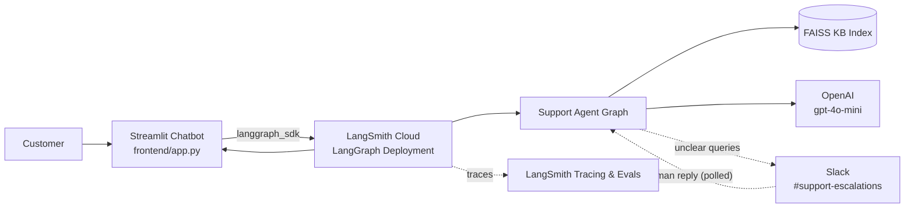
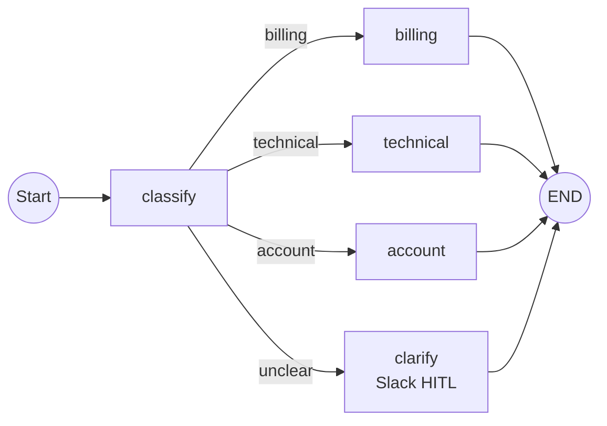
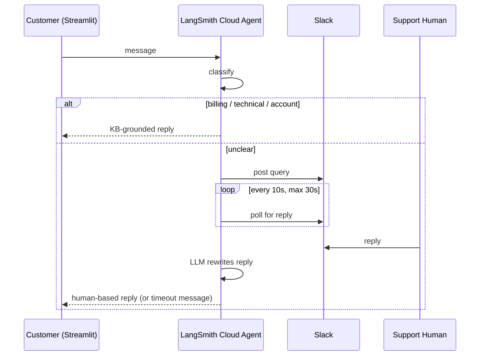

# Architecture

High-level blueprint of the customer-support triage system.

## System Overview

## Components

### 1. Streamlit Chatbot (Frontend)
- `frontend/app.py`: chat UI; one LangGraph thread per user session.
- Talks to the deployed agent via `langgraph_sdk` (API key from `st.secrets`).
- Streams the agent's reply (or a handoff notice) back to the user.

### 2. LangSmith Cloud Backend
- Hosts the LangGraph deployment (`graph` in `src/support_agent/graph.py`, id `support_agent`).
- Manages threads, state persistence, and run API.
- Tracing, datasets, and evals (`routing_correct`, `response_quality`) live in LangSmith.

### 3. Support Agent Graph

- `classify` → category + confidence.
- Department drafters retrieve from KB and answer **only** from retrieved text.
- No relevant docs → human handoff message.
- `unclear` → `clarify` asks a human in Slack (see §5).

### 4. Knowledge Base
- `kb/*.md` → `scripts/build_index.py` → `index/kb.faiss` + `meta.json`.
- `retriever.retrieve()` searches category + `general`, falls back to unfiltered below score 0.30.
- Embeddings: `text-embedding-3-small`.

### 5. Slack Human-in-the-Loop (Prototype, implemented)
Only for `unclear` queries. `clarify` calls `slack_hitl.ask_human()` (`src/support_agent/slack_hitl.py`):
1. Posts `Unclear query: <text>` to `#support-escalations` (`SLACK_BOT_TOKEN`, `SLACK_CHANNEL_ID`) via the Slack Web API.
2. Polls every 10s for up to 30s (blocking the node) for the first non-bot reply, either a thread reply or a plain channel message after the post.
3. Reply found -> the LLM rewrites it into a friendly message (meaning unchanged, no new facts) and returns it to the user.
4. No reply -> "Sorry, we are unable to reply to you at this moment."

Outbound HTTPS only (no Socket Mode / Events URL), so it works from LangSmith cloud.
Limits: no auth on who replies, no concurrency handling, polling latency up to 10s.
Later: `interrupt()` + Slack webhook (Bolt) with `Command(resume=...)` for async replies.

## Offline / Dev Workflow
- Edit `kb/` → rebuild index → redeploy.
- `evals/create_dataset.py` + `evals/run_eval.py` score routing and response quality in LangSmith.
- Local dev: `uv run langgraph dev`.

## External Dependencies
| Service | Purpose |
|---|---|
| LangSmith / LangGraph Cloud | Hosting, threads, tracing, evals |
| OpenAI | Classification, drafting, embeddings |
| Slack | Human reply for unclear queries (Web API, polling) |
| Streamlit | Customer-facing UI |
